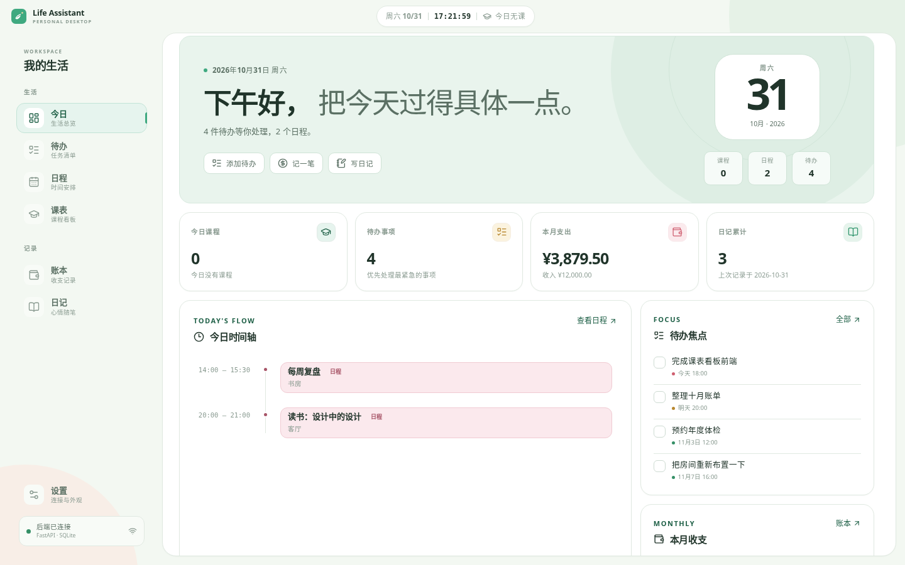
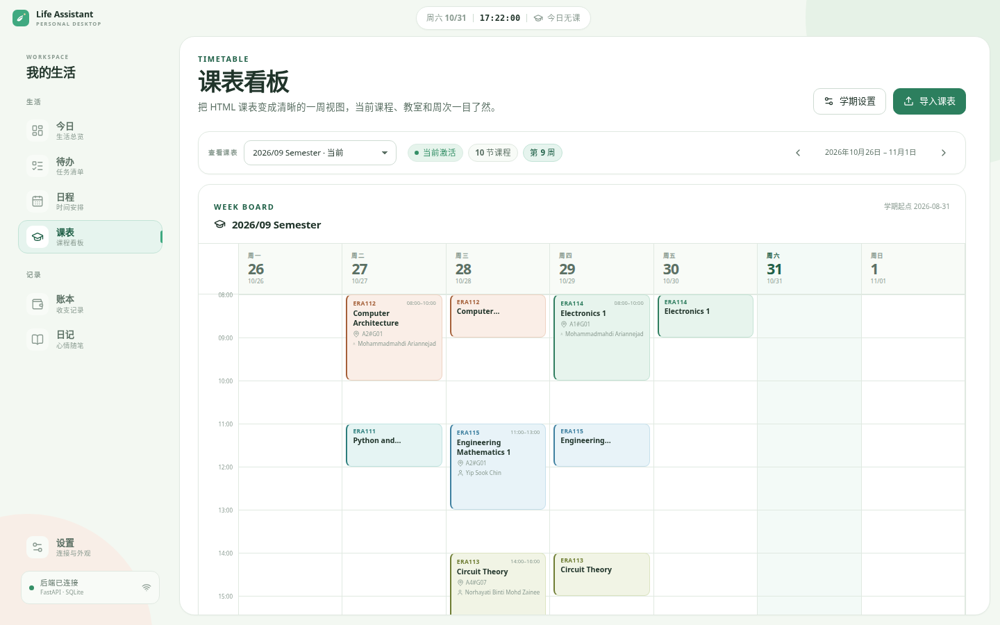

# Personal Life Assistant

个人生活助手：把待办、日程、课表、账本和日记放进同一个本地桌面工作台。

界面基于 Vue 3 + Electron，沿用 [ClassIsland](https://github.com/ClassIsland/ClassIsland) 的导航结构与悬浮信息岛概念，但采用浅色、扁平纯色和低饱和配色，整体风格清新轻盈。后端使用 FastAPI + SQLite，数据只保存在本机。



## 当前进度

- [x] FastAPI + SQLite 后端
- [x] TodoList / 记账 / 日程 / 日记 REST API
- [x] 课表 HTML 导入、周次解析与看板 API
- [x] Vue 3 前端：今日、待办、日程、课表、账本、日记、设置
- [x] Electron 跨平台桌面壳与自定义窗口控制
- [x] ClassIsland 风格桌面置顶浮窗，支持自定义板块与内容
- [x] 前后端 API 联调与基础交互验证
- [x] Electron 打包配置（Windows / macOS / Linux）
- [ ] 将 Python 后端打包进桌面安装包
- [ ] 系统托盘、课程提醒和桌面通知

## 界面预览

| 今日工作台 | 课表看板 |
| --- | --- |
|  |  |


## 桌面浮窗

在「设置 → 桌面浮窗」中开启后，会创建一个独立于主窗口的透明置顶浮窗，支持：

- 拖动到桌面任意位置，并可锁定位置；
- 显示/隐藏、双击打开主界面；
- 添加 1–8 个板块并自由排序；
- 板块内容可选时钟、日期、当前课程、今日课程、待办事项、下一日程、本月支出、日记状态和自定义文字；
- 配置和窗口位置自动保存，下次启动继续显示。

浮窗使用 Electron 标准的透明窗口、置顶窗口和无边框拖拽能力，适配 Linux 和 Windows。当前已在 Linux 环境实际验证，Windows 使用相同的跨平台 Electron API 实现。

## 快速开始

### 1. 启动后端

```bash
cd backend
python3 -m venv .venv
source .venv/bin/activate
pip install -r requirements.txt
uvicorn app.main:app --reload --host 127.0.0.1 --port 8000
```

### 2. 启动前端

```bash
cd frontend
npm install
npm run dev          # 浏览器：http://127.0.0.1:5173
npm run dev:desktop  # Electron 桌面窗口
```

界面会自动连接 `http://127.0.0.1:8000/api/v1`，也可以在设置页修改。

## 项目结构

```text
Personal-Life-Assistant/
├── backend/       # FastAPI + SQLAlchemy + SQLite
├── frontend/      # Vue 3 + Vite + Electron
├── docs/          # API 契约、OpenAPI 快照
└── README.md
```

## 文档

- [API 契约](docs/API.md)
- [OpenAPI JSON](docs/openapi.json)
- [后端说明](backend/README.md)
- [前端说明](frontend/README.md)

## 技术栈

| 层 | 选型 |
| --- | --- |
| 桌面壳 | Electron |
| 前端 | Vue 3 / Vue Router / Pinia / Vite / 纯 CSS 设计系统 |
| 后端 | FastAPI / SQLAlchemy / BeautifulSoup |
| 数据库 | SQLite |

## 说明

当前桌面安装包只包含 Electron 前端，Python 后端需要单独运行。若需要“双击即用”的完整安装包，下一步可将后端用 PyInstaller 打包，并由 Electron 主进程负责启动和退出。
